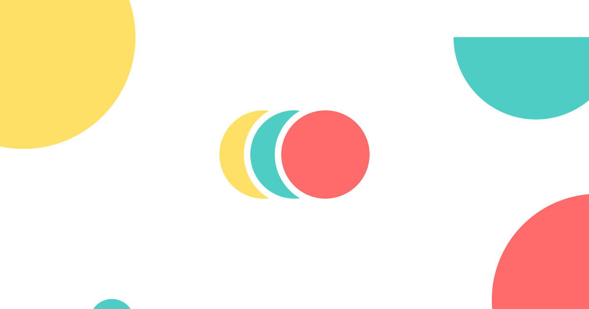
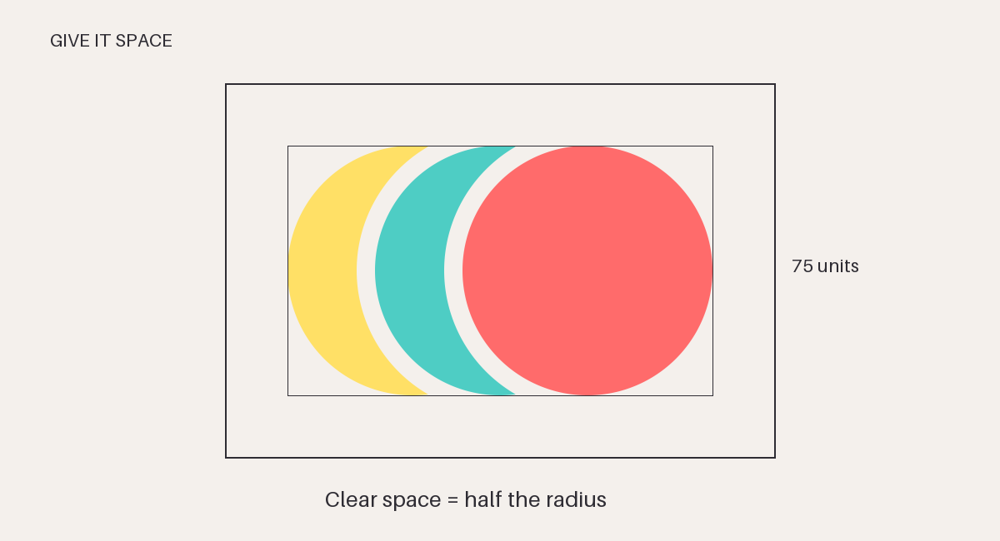
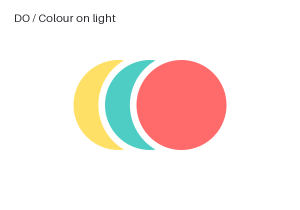
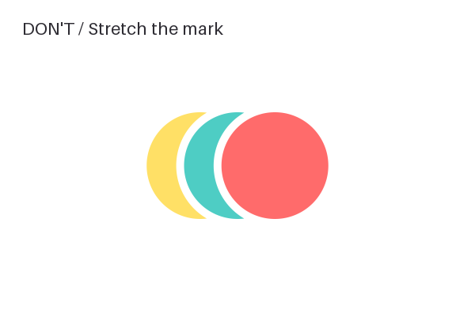
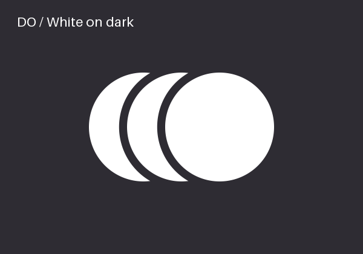
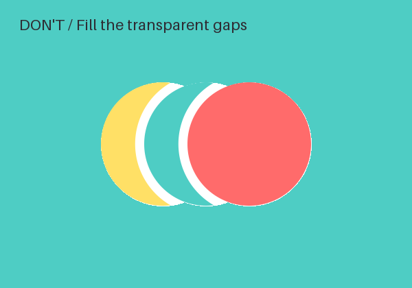
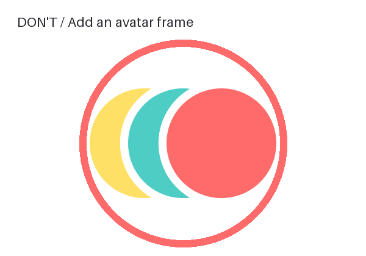
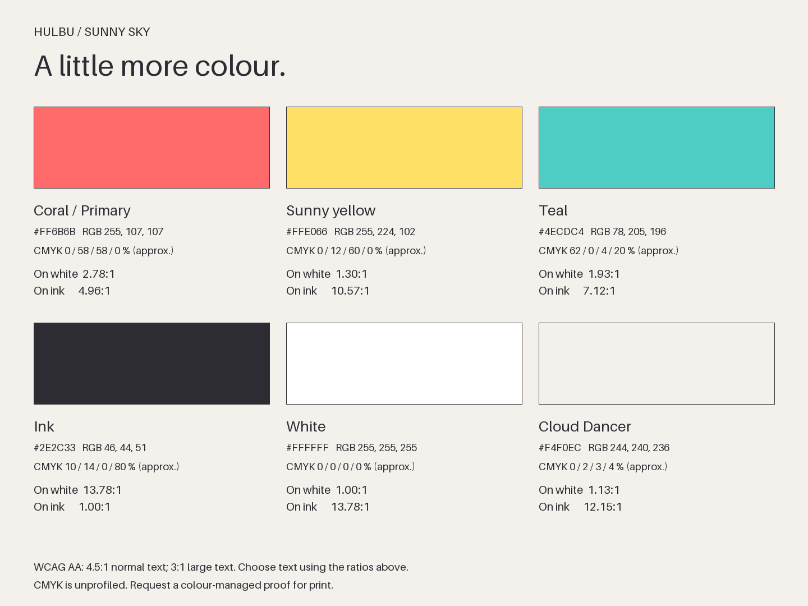

<!-- Generated by source/build.py; edit source/templates/README.md. -->
# Hulbu brand kit

Three circles. A sunny outlook. The official, reproducible home of Hulbu’s mark, colours and social assets.



## Find your file

| I need… | Start here |
| --- | --- |
| The logo on a light background | [Colour SVG](logo/hulbu-mark.svg) · [1024 px PNG](logo/png/hulbu-mark-1024.png) |
| A single-colour logo | [Coral](logo/hulbu-mark-coral.svg) · [Ink](logo/hulbu-mark-ink.svg) · [White for dark backgrounds](logo/hulbu-mark-white.svg) |
| A tiny logo | [32 px cut](logo/hulbu-mark-32.svg) · [16 px cut](logo/hulbu-mark-16.svg); all four colours in [logo/](logo/) |
| Favicons and app icons | [favicon/](favicon/) · [copy-paste HTML](favicon/head.html) · [manifest](favicon/site.webmanifest) |
| A profile picture | [Colour on white](social/profile/color-white/) · [Colour on Cloud Dancer](social/profile/color-cloud/) · [White on coral](social/profile/white-coral/) · [White on ink](social/profile/white-ink/) |
| A cover or link preview | [Default OG](social/covers/og-default.png) · [all backgrounds and covers](social/covers/) |
| Colour values for design or code | [Swatches](colors/swatches.png) · [JSON](colors/tokens.json) · [CSS](colors/tokens.css) · [TypeScript](colors/tokens.ts) |
| To review everything | Download the repo and open [preview.html](preview.html) locally |
| Platform sizes and crop decisions | [Platform notes and sources](PLATFORM-NOTES.md) |

**Wordmark pending.** The founder has not chosen a typeface. This kit contains the symbol only; typography in documentation is not an approved wordmark.

## The mark

The mark is three equal, perfect circles in a row: left at the back, centre in the middle, right at the front.
The visible crescents are created by transparent cuts, so the surface beneath always shows through.

- Original 1080-unit canvas: radius **150**, centres **(435, 540), (540, 540), (645, 540)**.
- Bounding box: **510 × 300**. The master SVG is tightly cropped to `viewBox="285 390 510 300"`.
- Standard gap: **22 units**. The `-32` cut uses **32 units**; the `-16` cut uses **44 units**.
- Every variant has transparent PNGs at **512, 1024 and 2048 px wide**, in [logo/png/](logo/png/). Heights are rounded to whole pixels.
- SVG artwork is plain paths with an accessible title; no masks, filters, text, strokes, or embedded fonts.

### Space and minimum size

Leave at least **75 design units** (half a radius, or 14.7% of the mark’s width) clear on every side.
The transparent master’s viewBox is tight: add this space in your layout.



For general display, use the standard cut at **48 px wide or larger**. From 24–47 px use the `-32` cut; from 16–23 px use `-16`.
**16 px wide is the minimum**. Prefer 32 px or more when the mark carries the identity on its own.
Favicons are a deliberate exception to the clear-space rule: square canvases give the tiny mark almost the full available width.

### Do / don’t

| Do | Don’t |
| --- | --- |
|  |  |
|  |  |
| Keep the order, circles, gaps and approved colours. |  |

Never rotate, redraw, change the circle sizes, rearrange the colours, add effects, or build a wordmark from an unapproved font.
The “don’t” pictures are instructional examples, not alternative assets.

## Sunny sky

**Coral is the primary colour.** “Orange” refers to this same token, not a separate shade. The mark’s back-to-front order is Sunny yellow → Teal → Coral.

| Colour | HEX | RGB | CMYK % (approx.) | On white | On ink |
| --- | --- | --- | --- | --- | --- |
| Coral (primary) | `#FF6B6B` | 255, 107, 107 | 0 / 58 / 58 / 0 | 2.78:1 | 4.96:1 |
| Sunny yellow | `#FFE066` | 255, 224, 102 | 0 / 12 / 60 / 0 | 1.30:1 | 10.57:1 |
| Teal | `#4ECDC4` | 78, 205, 196 | 62 / 0 / 4 / 20 | 1.93:1 | 7.12:1 |
| Ink | `#2E2C33` | 46, 44, 51 | 10 / 14 / 0 / 80 | 13.78:1 | 1.00:1 |
| White | `#FFFFFF` | 255, 255, 255 | 0 / 0 / 0 / 0 | 1.00:1 | 13.78:1 |
| Cloud Dancer | `#F4F0EC` | 244, 240, 236 | 0 / 2 / 3 / 4 | 1.13:1 | 12.15:1 |



Contrast uses the [WCAG relative-luminance calculation](https://www.w3.org/WAI/WCAG21/Understanding/contrast-minimum.html): normal text needs 4.5:1 and large text 3:1 for AA.
Ink meets AA for normal text on Coral, Sunny yellow, Teal. Coral, Sunny yellow, Teal on white fall below 3:1; white text on those colours also falls below 3:1. Logos have an exemption, which does not extend to interface text or essential controls.
CMYK values are mathematical, unprofiled approximations. Obtain a printer-specific colour-managed proof for production.

## Favicons, profiles and covers

Copy the `favicon/` directory to your public web root and paste [head.html](favicon/head.html) into your page’s head.
The snippet assumes `/favicon/`; change the paths if needed. Review the manifest’s `start_url`, `scope` and display mode for your application.
`favicon.svg` stays in colour. `favicon-auto.svg` turns white in dark mode. PNG and ICO fallbacks stay in colour.
The ICO embeds the individually rendered **16 / 32 / 48 px** files with their own tuned cuts (44 / 32 / 22 units).
Apple’s 180 px icon has a white background. The maskable 512 px icon is opaque white and keeps the complete mark inside the [80%-diameter safe circle](https://www.w3.org/TR/appmanifest/#icon-masks).

Profile exports include **1080 px masters**, Instagram **320**, LinkedIn **400**, YouTube **800**, X **400**, Facebook **720** and TikTok **200**.
Every profile has only a centred mark on its background, with no outside ring, border or frame. The mark is 68% of the square’s width, comfortably inside a circular crop.

Covers come in background-only and with-logo pairs. `og-default.png`, `og-orbit.png` and `og-confetti.png` are the three marked OG options; their `-background.png` partners leave the middle open.
Other covers use `-background.png` and `-with-logo.png` suffixes. The mark never goes under the conservative avatar envelopes shown in the preview.
LinkedIn includes both the brief’s 1128 × 191 cover and the current **1512 × 256** upload size. Facebook includes the requested 1640 × 624 and a recommended 851 × 315 option.
See [the dated size checks and crop notes](PLATFORM-NOTES.md) before uploading; platform interfaces can crop differently.

## Regenerate the kit

Requires Python 3.10+ and the pinned packages in [source/requirements.txt](source/requirements.txt).

```sh
python3 -m venv .venv
. .venv/bin/activate
python3 -m pip install -r source/requirements.txt
python3 source/build.py
python3 source/validate.py
```

After setup, **`python3 source/build.py`** regenerates every public asset and this page offline. `npm run build` is an alias.
CairoSVG needs the Cairo system library; if missing, install it with `brew install cairo` on macOS or your OS package manager.
Edit [source/brand.json](source/brand.json) for an approved colour change. `palette.primary.hex` is the only source value for coral; tokens, art, examples and documentation follow it.
Do not edit generated files. [Source notes](source/README.md) explain the geometry, validation, templates and optional browser checks.
The unchanged [studio references](source/favicon-from-studio/) are historical inputs, not files to ship.

## Permission to use

You may copy and use these files to identify or refer to Hulbu, including in press, partner pages and integrations.
The Hulbu name and logo remain trademarks; this grants no ownership or endorsement. Read the [full terms](LICENSE).
